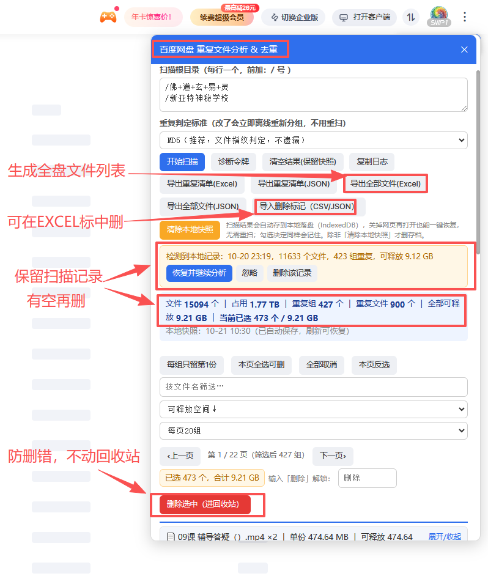

# 百度网盘 文件分析 & 去除重复

一个运行在百度网盘网页端（`pan.baidu.com` / `yun.baidu.com`）的重复文件分析 & 去重工具。支持递归扫描指定目录、多种判定标准、结果本地落盘断点续扫、分页筛选排序、导出 CSV/JSON 线下研判、导入删除标记按标记删除（进回收站，10 天可恢复）。



> 上图为插件运行界面：左侧红色手写注释为作者自用备注（已保留原样），分别指向「生成全盘文件列表」「可在 Excel 标中删」「保留扫描记录有空再删」「防删错，删除进回收站而非永久删除」。

提供两种形态，功能完全一致：

- `baidu_netdisk_dedup.user.js` —— Tampermonkey 用户脚本（推荐，安装最简单）
- `baidu_netdisk_dedup_crx/` —— Chrome 扩展（Manifest V3，无需安装 Tampermonkey）

## 功能

- **递归扫描**：遍历你指定的根目录（每行一个，路径前加 `/`），自动翻页、进入子目录。
- **四种判定标准**：
  - 文件名 + 大小（高效）—— 常用复制场景快速归类
  - MD5（推荐，文件指纹判定，不遗漏）—— 字节级一致为真重复
  - 文件名 + MD5（最严格）—— 文件名与内容均相同才判重
  - （另含按 MD5 分组的变体）
- **结果持久化**：扫描结果自动存入 IndexedDB（localStorage 兜底），关页面/刷新/重启浏览器均可一键恢复，无需重扫；断点续扫；勾选决策同样记住。
- **结果浏览**：分页（20/50/100/300）、文件名筛选、按可释放空间/副本数/文件名排序；勾选状态翻页不丢。
- **导出**：
  - 重复清单 CSV（Excel，含 `删除标记（1表示确定删）`）/ JSON
  - 全部文件 CSV / JSON（盘点网盘内容，含所在目录 / 大小 / MD5 / 是否重复 / 重复组号）
- **导入删除标记**：在 Excel 里把要删的行「删除标记」填 `1`，另存 CSV → 「导入删除标记」→ 勾选自动匹配 → 输入「删除」执行（走回收站）。
- **删除防护**：分批 20 个、批间 1 秒限速、勾选 + 输入「删除」+ confirm 三道关；删除进回收站，10 天可恢复。

## 安装

### 方式一：Tampermonkey（推荐）

1. 浏览器安装 [Tampermonkey](https://www.tampermonkey.net/) 扩展。
2. 打开 `baidu_netdisk_dedup.user.js` → Tampermonkey 提示安装/更新。
3. 登录 `pan.baidu.com` → 页面右上角出现「网盘文件扫描与去重」按钮 → 点开使用。

### 方式二：Chrome 扩展（无需 Tampermonkey）

> Chrome 73+ 已禁止直接拖入本地 `.crx` 安装，请走「加载已解压的扩展程序」。

1. 打开 `chrome://extensions`，右上角开启**开发者模式**。
2. 点**加载已解压的扩展程序** → 选中 `baidu_netdisk_dedup_crx/` 文件夹。
3. 登录 `pan.baidu.com` → 右上角出现「网盘文件扫描与去重」按钮 → 使用。

## 使用流程

```
扫描 → 结果自动落盘（可关页面，下次一键恢复）
     → 翻页/筛选研判，或导出 CSV 去 Excel 排序
     → 标记要删的行 → 另存 CSV → 导入删除标记
     → 核对「已选 N 个 / 合计 X」→ 输入「删除」→ 分批删（进回收站）
```

## 判定标准怎么选

- 想快速归类同名同大小的副本 → 文件名 + 大小（高效）。
- 想确保不遗漏任何内容相同的副本（改名也认得出） → MD5（推荐）。
- 只想匹配"文件名与内容都一致"的最保守档 → 文件名 + MD5（最严格）。

## 合规与风险提示

本工具运行在你自己的浏览器、你自己的已登录账号里，操作你自己的文件；调用的是百度网盘网页端自身就在用的公开 Web API（列文件、删除到回收站），非破解接口、不碰他人数据、不注入广告；本质是把你手动能做的事自动化，无盗号、绕过付费、刷量、牟利型外挂特征。

风险与防护：

- 删除走回收站（10 天可恢复）——误删可救回。
- 分批 20 个、批间 1 秒限速、三道确认关——降低风控触发概率与误操作。
- 插件免费，**禁止用于商业用途、禁止代操作他人网盘、禁止传播牟利，责任自付**。
- 批量列举 + 批量删除可能触发百度反滥用机制（临时限制操作、弹验证码、短时封禁删除功能），遇此请停手隔段时间再继续。

## 目录结构

```
baidu_netdisk_dedup.user.js      # Tampermonkey 用户脚本（入口）
baidu_netdisk_dedup_crx/         # Chrome 扩展（Manifest V3）
  ├── manifest.json
  └── content.js                 # 由 user.js 摘头生成，功能一致
test_dedup.js                    # 纯函数单元自测（node 运行）
```

## 免责声明

本工具按"现状"提供，作者不对使用后果（含误删、账号限制等）承担责任。使用者须遵守百度网盘用户协议与当地法律法规。
